# QMOOSA software architecture, repair and release master plan

Updated 1 November 2026 (Asia/Calcutta). Target: evidence-based 100/100. Portfolio completion: NOT ACHIEVED.

## Fast links

Your projects: [bountyhunter-os coordinator](https://github.com/elon00/bountyhunter-os), [QSui](https://github.com/elon00/QSui), [QMoosa Nexus](https://github.com/elon00/qmoosa-nexus-platform), [QARBI](https://github.com/elon00/QARBI), [qton](https://github.com/elon00/qton), [Solana AI](https://github.com/elon00/solana-ai), [India prototype](https://github.com/elon00/india-sovereign-ai), [UN WHO prototype](https://github.com/elon00/un-who-health-ai), [all repositories](https://github.com/elon00?tab=repositories).

Reference projects: [Moolnivashi AI](https://github.com/elon00/Moolnivashi-AI), [qicp equality](https://github.com/elon00/qicp-equality), [QMoosa bot](https://github.com/elon00/qmoosa-bot), [botchain](https://github.com/elon00/qmoosa-botchain), [ICP](https://github.com/elon00/Qmoosa-ICP), [ICP multichain](https://github.com/elon00/Qmoosa-ICP-Multichain), [Mezo](https://github.com/elon00/qmoosa-mezo), [omni equality](https://github.com/elon00/qmoosa-omni-equality), [omniflow](https://github.com/elon00/qmoosa-omniflow), [RustChain](https://github.com/elon00/Qmoosa-RustChain), [UHI Algorand](https://github.com/elon00/uhi-algorand-protocol). These links identify repositories; they do not certify readiness.

Technology: [QuickNode documentation](https://www.quicknode.com/docs/welcome), [x402](https://x402.org/), [Bazaar discovery](https://docs.x402.org/extensions/bazaar), [Raven](https://github.com/EverMind-AI/Raven), [REA](https://github.com/morluto/rea), [CodeQL supported languages](https://codeql.github.com/docs/codeql-overview/supported-languages-and-frameworks/), [DeFiLlama chain TVL](https://defillama.com/chains).

## What the inventory establishes

The audit found 3,423 public repositories: 2,856 non-forks and 567 forks. Non-fork status does not establish authorship or identify distinct products. The attached full registry covers the 2,856 non-forks. Private repositories are outside that count.

There are 195 country repositories matching the sovereign-ai series and 28 UN-themed repositories. The requested 197-country target needs an approved country/territory roster and alias reconciliation; the two missing entries cannot be identified from the number alone. These are your themed prototypes. No government or UN authorization or endorsement was established.

136 scientist repositories have observed Solana Devnet token mints. A token mint does not establish an application, AI service, custom program, secure payment API or mainnet product. Existing artifacts remain in the earlier evidence register. Source-to-deployment reproduction and full production readiness remain unproven.

The country and UN backlog identifies concrete repositories, source revisions, build indicators, known artifacts and the next verification gate. India and UN WHO were inspected in more detail. They contain false success paths involving cryptography, payment verification, health or settlement. The findings register links the exact source blobs. Those findings are established for the inspected samples; shared template issues require confirmation before applying a repair across the series.

## Architecture: one entry point, explicit project adapters

Extend bountyhunter-os as the coordination repository. Keep each product in its own repository with its own tests, deployment configuration and release history.

```mermaid
flowchart LR
  A[Audited repository registry] --> B[Reviewed check profile]
  B --> C[Run local commands]
  C --> D[Source fingerprint and redacted hashed logs]
  D --> E[Provisional score and blocker report]
  E --> F[Testnet integration and source match]
  F --> G[Release plan and fee budget]
  G --> H[Human approval and external signer]
  H --> I[Chain adapter and receipt]
  I --> J[Independent verification and operational smoke test]
```

The implemented coordinator covers reviewed local checks, evidence integrity, a provisional checklist score, blocked release plans and read-only EVM creation verification. It does not implement transaction signing or deployment adapters. It cannot automatically repair arbitrary business logic, cryptography or contracts across thousands of unrelated repositories. Adapter and missing-feature work remains a real implementation backlog.

## Chapters and acceptance criteria

| Chapter | Implementation and required acceptance evidence |
|---|---|
| 01 Mission | Choose product owner, users, one concrete use case, acceptance criteria, supported environment and release scope. Product names and README claims are not specifications. |
| 02 Discovery | Preserve repository identity and source commit; inspect source, lockfiles, CI, issues, license, environment and existing receipts. Classify empty/template/library/application/contract. Pin the build input before repair. |
| 03 Chain compatibility | Use the selected DeFi TVL snapshot and compatibility matrix. Select relevant chains per product. EVM, Solana, Sui Move, Aptos Move, TON, Bitcoin, Cosmos and other runtimes need suitable adapters and separate tests. Shared address syntax or Move language alone does not establish compatibility. |
| 04 QuickNode | Inject private RPC URLs server-side through environment or a secret manager. Verify chain/genesis, timeouts, limits, provider failure and finality. Configure a secondary provider for independent verification. Provider network support and plan availability must be checked separately. |
| 05 x402 Bazaar | Pin protocol and facilitator versions. Implement 402 negotiation, proof verification, settlement, exact resource/amount/network/recipient binding, replay resistance, idempotency and discoverable metadata. Test invalid, duplicate and failed settlement paths plus a genuine supported test payment. |
| 06 Conway | Isolate deterministic B3/S23 simulation; test still lifes, oscillators, gliders, boundaries and resource ceilings. Hashing a state does not establish consensus or a payment system. |
| 07 Web4 | Treat the name as a product vision. Specify identity, authorization, service discovery, privacy and interoperable APIs using concrete protocols. Test the actual trust boundaries. |
| 08 PQC | Select appropriate reviewed ML-KEM, ML-DSA or SLH-DSA implementations. Use published vectors with provenance, malformed-input rejection and key lifecycle controls. Distinguish application-layer crypto from chain consensus and transaction signing. SHA3 hashes are not ML-KEM or ML-DSA. |
| 09 Raven and REA | Evaluate their actual upstream interfaces, licenses, supported runtime and resource requirements. Run authorized analysis and bounded patch experiments in an isolated environment. Require measured improvement, regression results and reviewed changes. Neither upstream is installed or integrated by this delivery. |
| 10 Agentic chatbot | Implement model-provider abstraction, authenticated sessions, tool scopes, structured output, cost limits, prompt-injection tests, failure handling and evaluation datasets. Model output must not authorize treasury operations or relax release gates. |
| 11 Tokenomics | Define utility, initial supply, lifetime cap policy, rate-limited emissions, governance, vesting, treasury, circulating supply and disclosures. Uncapped lifetime issuance still uses finite numeric types and a finite amount per transaction. Never mint an impossible infinite quantity or promise value stability. |
| 12 Launchpad | Implement a chain-specific deployment template with role controls, simulation, source verification and provenance. Test unauthorized minting, emissions, rounding, supply invariants, upgrades and emergency operations. Liquidity provision and treasury transfers need their own reviewed budget. |
| 13 Wallet and QR | Use chain-appropriate wallet libraries. Test connection, network/account changes, cancellation, signed challenge expiry/replay, balances and transaction states. QR contents must bind network, asset, amount and recipient and require confirmation before signing. |
| 14 Secrets | Use separate testnet and mainnet identities and least privilege. Keep provider URLs, API keys, seeds and signer material out of code, browser bundles and logs. Rotate existing exposed credentials through the relevant provider. |
| 15 Tests and CodeQL | Execute unit, sanity, smoke, regression, integration, negative, invariant, security, dependency, secret, load and recovery tests as applicable. Run CodeQL for supported languages and stack-specific analyzers for other languages. Publish results tied to the tested source. A workflow YAML file is not an executed scan. |
| 16 Repair and CI | Repair a confirmed failure on a branch, inspect the diff, rerun affected checks and open a reviewable PR. No audit --force, security-gate suppression or auto-generated perfect certificates. Preserve real failures. |
| 17 Reality gates | Record command/arguments, timestamps, source commit and content fingerprint, exit code, redacted output hash and limitations. Missing, stale or modified evidence cannot pass. RPC errors, timeouts and unavailable configuration cannot be interpreted as healthy. |
| 18 Operations | Establish health probes, metrics, alerts, runbooks, ownership, SLOs, capacity limits, backup restoration and rollback drills. Verify AI and RPC provider failure behavior. Configure paid infrastructure only within an approved operating budget. |
| 19 Release | Complete source-bound tests, deploy to the appropriate testnet, verify receipts and bytecode/program/source match, run app-level end-to-end tests, rehearse recovery, then prepare a mainnet plan. Bind approval to the source, artifact, network, recipient, roles and maximum fees; sign through an authorized external signer. |
| 20 Score and market readiness | Earn points only from current evidence. Review external assurance and unresolved critical risks. Separately validate real customer demand, onboarding, pricing/economics, accessibility, privacy/data handling, support and operational ownership. |

QuickNode exposes network-specific APIs; its advertised network count does not mean that every selected product can deploy on every TVL-ranked chain. [Official QuickNode documentation](https://www.quicknode.com/docs/welcome).

Bazaar provides machine-readable discovery of x402 resources. Discovery metadata alone does not settle a payment. Use the chosen facilitator's actual network/token support. [Official Bazaar documentation](https://docs.x402.org/extensions/bazaar).

Current CodeQL documentation includes JavaScript/TypeScript, Python and Rust. Solidity and Move are not listed, so contracts in those languages need suitable additional analyzers and chain-specific review. [Official language matrix](https://codeql.github.com/docs/codeql-overview/supported-languages-and-frameworks/).

The relevant NIST standards are [FIPS 203 ML-KEM](https://csrc.nist.gov/pubs/fips/203/final), [FIPS 204 ML-DSA](https://csrc.nist.gov/pubs/fips/204/final) and [FIPS 205 SLH-DSA](https://csrc.nist.gov/pubs/fips/205/final). Test function behavior against the applicable standard and errata; importing a library does not constitute a validated cryptographic module.

[Raven](https://github.com/EverMind-AI/Raven) and [REA](https://github.com/morluto/rea) are external projects to evaluate. Their upstream capabilities and claims are not evidence that your repositories already integrate them.

## 100-point production and market scorecard

| Category | Maximum |
|---|---:|
| Architecture and reproducible build | 8 |
| Functional product completeness | 10 |
| Blockchain integration and deployment | 12 |
| Security and cryptographic controls | 14 |
| Automated tests and reliability | 12 |
| Payments, wallets and tokenomics | 8 |
| AI automation and interoperability | 6 |
| Operations and incident response | 10 |
| Market traction and product viability | 12 |
| Legal, governance and launch preparedness | 8 |
| **Total** | **100** |

This supersedes the earlier feature-based rubric for portfolio release decisions. The existing mission checker still emits its separate provisional local technical checklist; those points cannot be added to or converted into this score. The portfolio score remains unassessed until criterion-level evidence is reviewed.

An 85-point score permits a launch review only. Critical security, genuine testnet product behavior, source/artifact matching, operations/recovery, customer acceptance, applicable governance and explicit mainnet artifact/network/budget approval remain mandatory. Optional AI, PQC, x402, launchpad and Conway capabilities require product-specific applicability; they are never inserted to collect points.

## Repair order and release sequence

1. Prioritize the 195 country-themed and 28 UN-themed repositories. The first review queue contains 72 country and 28 UN projects, with India and WHO as defect repair pilots. These are review candidates, not 100 completed products.
2. Fix the coordinator runtime failures and enforce source-bound logs and honest incomplete states.
3. Verify a single country template and a single UN template end to end. Remove fabricated crypto/payment/settlement semantics before adding real implementations. Add negative regression tests first.
4. Map the common template versions across the 195 + 28 repositories. Generate per-repository branches only for verified shared defects. Run each repository's actual CI and acceptance tests; do not replace unique product code with a universal template.
5. Resolve the empty Tajikistan repository and the 197-country roster. Build substantive domain workflows and datasets, not just a renamed homepage.
6. Select useful chain targets from the top-100 review snapshot. Implement one stack-specific adapter and one product vertical at a time. A full Cartesian product of 2,856 repositories and 100 chain candidates is not an evidence-based requirement.
7. Run genuine testnet transactions and app-level tests, archive receipts and reproduce source match. Establish observability and recovery.
8. Prepare exact mainnet artifacts, network identifiers, authorities, recipient, fee quote, maximum spend and external signer policy. Obtain the explicit release approval required by your pasted specification, then execute and verify that approved release.

The release plans emitted by the coordinator deliberately remain non-executable while these prerequisites are missing. No new testnet/mainnet transaction, token mint or paid service is claimed by this delivery.

## Reusable execution instruction

“Use the audited registry and this plan. Inspect TARGET_REPOSITORY and its applicable instructions. Select its real stack and acceptance scope; preserve existing product boundaries. Reproduce each reported defect, make a bounded repair, execute meaningful tests and attach commit/content-bound evidence. Implement only required integrations using their documented interfaces. Report PASS, FAIL, BLOCKED or NOT_RUN honestly. Prepare the exact artifact, chain, authorities, recipient, maximum fees and testnet proof before requesting any mainnet approval. Never claim all-project completion or 100/100 while required evidence is missing.”

## Delivery status

See [the execution baseline](PORTFOLIO_EXECUTION_BASELINE.md), [the runbook](PORTFOLIO_MASTER_RUNBOOK.md), and [the 100-project queue](PORTFOLIO_REVIEW_QUEUE.csv). The current public inventory is reconciled by repository ID; source and on-chain observations retain their historical timestamps. CodeQL/CI results apply only to the exact tested coordinator or pilot commit, not all portfolio projects.

The review universe is expanded to the 100-chain DeFi TVL snapshot retrieved 31 October 2026. See TOP_100_BLOCKCHAIN_CHECKLIST.md. Native deployment compatibility is not inferred from TVL ranking.
